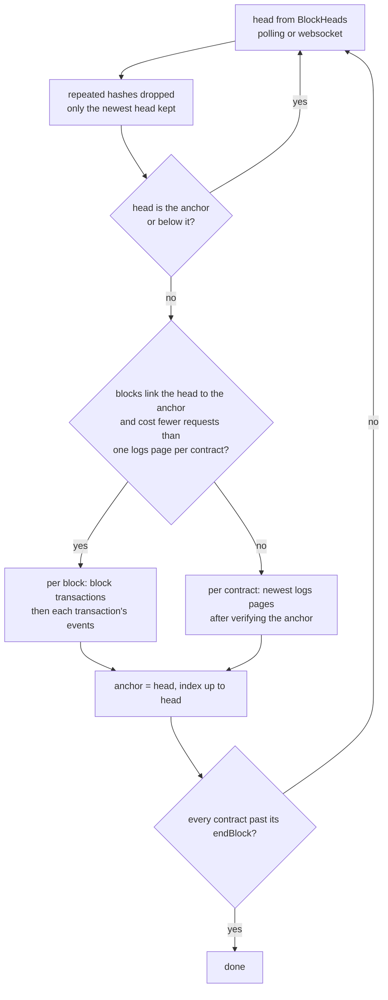

# Stacks Blockchain Indexer Architecture

A blockchain indexer fetches raw data from a Stacks node, caches it locally, and transforms it into queryable tables through user-defined handlers.

This architecture assumes a single Stacks network per indexer instance.

## Architecture Overview

```
┌──────────────┐     ┌──────────────┐     ┌──────────────┐     ┌──────────────┐
│    Stacks    │────▶│    Syncer    │────▶│   Indexer    │────▶│     API      │
│     API      │     │              │     │              │     │   (read)     │
└──────────────┘     └──────┬───────┘     └──────┬───────┘     └──────────────┘
                            │                    │
                            ▼                    ▼
                     ┌──────────────┐     ┌──────────────┐
                     │  Sync Store  │     │ User Tables  │
                     │   (cache)    │     │  (indexed)   │
                     └──────────────┘     └──────────────┘
```

## Components

### Syncer

Fetches raw blockchain data from the Stacks API and stores it in the sync store.

Responsibilities:

- Fetch events using cursor-based pagination
- Fetch transactions and blocks for event context
- Track sync progress with cursors and block heights
- Handle historical backfill and realtime updates

### Sync Store

PostgreSQL / PGlite tables that cache raw blockchain data. This avoids re-fetching data on restarts and enables efficient queries during indexing. They live in the `stacksindex` Postgres schema, and their migrations are tracked in `stacksindex.__drizzle_migrations`; opening the database (`create`, or `layer` with the Effect API) applies them.

### Indexer

Processes events from the sync store: decodes each print, parses it with the contract's `print` schema, and executes the contract's handler with a database scoped to the batch transaction and a read-only contract client.

### User Tables

PostgreSQL tables defined by the user's schema, in the same database as the sync store (by default in `public`). These store the transformed/indexed data that applications query. The user creates them with drizzle-kit migrations passed as the `migrations` folder and applied when the database opens, after the sync store's, tracked in drizzle's default `drizzle.__drizzle_migrations`.

## Configuration

Users configure the indexer with four elements:

```
┌─────────────────────────────────────────────────────────────┐
│                      CONFIGURATION                          │
├─────────────────┬───────────────────────────────────────────┤
│  Chain          │  Stacks chain, API endpoint and settings  │
├─────────────────┼───────────────────────────────────────────┤
│  Contracts      │  Named contract IDs, ranges, schemas      │
├─────────────────┼───────────────────────────────────────────┤
│  Schema         │  Output table definitions                 │
├─────────────────┼───────────────────────────────────────────┤
│  Handlers       │  Event processing functions               │
└─────────────────┴───────────────────────────────────────────┘
```

### Chain

Define the Stacks chain to connect to (`chain`: `"mainnet"`, `"testnet"` or `{ id, apiUrl }`):

- API endpoint URL (`api.url`, defaulting to the chain's, e.g. `https://api.hiro.so`)
- Optional API key (`api.apiKey`)
- How live sync detects new blocks: `live.transport` (`"polling"` or `"websocket"`), `live.pollingInterval`, `live.webSocketUrl`

### Contracts

`defineIndexer({ contracts, relations? })` names every contract to capture:

- Contract ID (`id`, e.g. `SP6P4EJF0VG8V0RB3TQQKJBHDQKEF6NVRD1KZE3C.satoshibles`)
- Block range (`startBlock`/`endBlock`)
- Optional `print` schema (Standard Schema for the promise API, Effect `Schema` for the Effect API) and `onInvalid` (`"fail"` or `"skip"`)

The definition name (the key in `contracts`) identifies the contract in handlers, events, run results, status and metrics. `defineIndexer` validates ids, duplicates and ranges synchronously, throwing `ConfigurationError`.

### Schema

Define output tables using standard SQL types:

- Table names and columns
- Primary keys
- Indexes and constraints

### Handlers

Define transformation logic:

- One handler per contract name, passed as `handlers` to `create`/`layer` (exhaustive at compile time); `indexer.handler(name, fn)` types one defined in its own module
- Receives the decoded event (`PrintEvent`, `data` typed by the contract's `print` schema)
- Has access to:
  - `db`: the indexer database scoped to the batch transaction, which also stores the checkpoint; typed with the definition's Drizzle `relations` (`context.db` in the promise API, `yield* indexer.Db` in the Effect API)
  - `client`: provides `callReadOnly(options)` pinned to the event's block for time-travel contract state lookups (supports both typed with `abi` and untyped calls). The node pins reads by index block hash only, so `tip` defaults to the event's `block.indexBlockHash`, stored with its block during sync; an explicit `tip` must be an index block hash (`context.client`, or `yield* indexer.Client`)

## Stacks Event Structure

Events from the Stacks API have this structure:

```
Event {
    event_index: number
    event_type: string                  -- "smart_contract_log", "stx_transfer", etc.
    tx_id: string                       -- Transaction ID
    contract_log: {
        contract_id: string             -- e.g., "SP6P4EJF...satoshibles"
        topic: string                   -- e.g., "print"
        value: {
            hex: string                 -- Raw Clarity hex (e.g. "0x0100000000000000000000000000000001")
            repr: string                -- Human-readable representation: "(tuple (action \"mint\") (id u1))"
        }
    }
}
```

Key differences from EVM:

- No topics array (topic0-3) - instead has `topic` field (usually "print")
- Event data is a Clarity value (hex + repr) not raw ABI-encoded bytes
- Events are linked to transactions via `tx_id`, not directly to blocks
- Filtering by contract only - event type filtering done locally

## Data Flow

```
1. SYNC PHASE (Historical)

   Step A: Initial Cursor Discovery (Genesis Bootstrap)
   ┌──────────────────────────────────────────────────────────┐
   │ 1. GET /extended/v3/smart-contracts/{contract_id}        │
   │    -> Get deployment block height                        │
   │ 2. GET /extended/v3/principals/{principal}/transactions  │
   │    ?cursor={startBlock}:0:0                              │
   │ 3. GET /extended/v3/transactions/{tx_id}/events          │
   │    (skipped when the summary's event_count is 0)         │
   │    -> Find first matching smart_contract_log             │
   │ 4. Construct 4-part cursor                               │
   │    (block_height:microblock_sequence:tx_index:event_index│
   │    microblock_sequence: 2147483647 from epoch 2.5, else  │
   │    GET /extended/v1/tx/{tx_id}                           │
   └────────────────────────┬─────────────────────────────────┘
                            │
                            ▼
   Step B: Event Ingestion & Cache (backfill)
   ┌──────────────────────────────────────────────────────────┐
   │ Fetch events with cursor:                                │
   │ GET /extended/v2/smart-contracts/{contract_id}/logs      │
   │     ?cursor={cursor}&limit=100                           │
   │ Follow next_cursor until it is null                      │
   └────────────────────────┬─────────────────────────────────┘
                            │
                            ▼
   Step C: Catch-up from the newest events
   ┌──────────────────────────────────────────────────────────┐
   │ GET /extended/v2/smart-contracts/{contract_id}/logs      │
   │     ?limit=100            (no cursor = newest page)      │
   │ Follow prev_cursor back to syncedBlockHeight             │
   │ Nothing newer than syncedBlockHeight: done (1 request)   │
   └────────────────────────┬─────────────────────────────────┘
                            │
                            ▼
   ┌──────────────────────────────────────────────────────────┐
   │ For each page (oldest first):                            │
   │ - Batch fetch missing txs: GET /extended/v3/transactions/│
   │   batch (up to 20 tx_ids per request)                    │
   │ - Extract missing blocks from transactions in memory     │
   │ Store in sync store: events, transactions, blocks        │
   │ Update cursor and syncedBlockHeight in sync_progress     │
   └────────────────────────┬─────────────────────────────────┘
                            │
2. INDEX PHASE              ▼

   ┌──────────────────────────────────────────────────────────┐
   │ Query events from sync store (events joined with tx & blk│
   │ Order by block_height, tx_index, event_index             │
   └────────────────────────┬─────────────────────────────────┘
                            │
                            ▼
   ┌──────────────────────────────────────────────────────────┐
   │ Decode the print, parse it with the `print` schema       │
   │ (mismatch: EventDecodeError, or skip with onInvalid)     │
   │ Execute the contract's handler with the PrintEvent       │
   │ Handler writes to user tables                            │
   └────────────────────────┬─────────────────────────────────┘
                            │
                            ▼
   ┌──────────────────────────────────────────────────────────┐
   │ Update checkpoints table                                 │
   └──────────────────────────────────────────────────────────┘
```

### Pagination Cursor

The Stacks API v2 uses a cursor with the structure:

```
block_height:microblock_sequence:tx_index:event_index
```

Example: `100:0:5:2` means block height 100, microblock sequence 0, transaction index 5, event index 2.

The logs endpoint returns events newest first, limited to the canonical chain. A `cursor` selects the events at or below it. In the response:

- `cursor` is the newest event on the page.
- `next_cursor` is the event one full page newer. It is `null` whenever fewer than `limit` newer events exist, so following `next_cursor` alone never reaches the newest events.
- `prev_cursor` is the newest event of the next older page.

#### Why Cursor Discovery is Required

Because a cursor selects events at or below it, paging forward from `startBlock` requires the cursor of the first event at or above it. Synthesized cursors such as `${startBlock}:0:0:0` select older events instead, and older API versions reject cursors that do not match an existing event.

To resolve the initial cursor:

1. Fetch contract metadata via `GET /extended/v3/smart-contracts/{contract_id}` to obtain its deployment `block.height`.
2. Jump straight to the deployment or requested `startBlock` using `GET /extended/v3/principals/{principal}/transactions?cursor=${startBlock}:0:0`.
3. Scan transactions in chronological order and query `GET /extended/v3/transactions/{tx_id}/events` to locate the first `smart_contract_log` for that contract. Transactions whose summary reports `event_count: 0` are skipped without a request.
4. Construct the exact 4-part cursor (`block_height:microblock_sequence:tx_index:event_index`) to begin forward pagination with `/logs`. V3 summaries lack `microblock_sequence`. From epoch 2.5 on, blocks cannot confirm microblocks, so it is `2147483647` (anchor block) when the transaction's Bitcoin block is at or after the epoch 2.5 start: 840,360 on mainnet, 6 on testnet (devnets share the testnet chain ID). Older transactions, and every transaction on other chains, take it from `GET /extended/v1/tx/{tx_id}`.

Discovery runs only for a contract's first sync, and as a fallback when a catch-up backlog exceeds 10 pages.

## Sync Modes

### Historical Sync

Backfills past blockchain data using cursor-based pagination, from oldest to newest, then catches up from the newest events.

```
Start Block ──────────────────────────────────▶ Latest
             [page 1] → [page 2] → ... → [last full page]   [head] ← [older] ← ...
                            │                                  │
                       (next cursor)                     (prev cursor)

- Discover initial cursor at startBlock / deployment block
- Use "next_cursor" from response to paginate forward through history
- When "next_cursor" is null, fetch the newest page and follow "prev_cursor"
  back to syncedBlockHeight, then store those pages oldest first
- For each page of events:
  - Batch fetch transactions (deduplicated by tx_id)
  - Extract blocks by hash from transaction payloads in memory
- Store everything in sync store
- Save cursor and syncedBlockHeight to sync_progress to enable resume after restart
```

`sync_progress.syncedBlockHeight` guarantees every event of the contract at or below it is stored. A run for a caught-up contract fetches only the newest page; when its newest event is at or below `syncedBlockHeight`, the contract is up to date after a single request. A contract that finished on its newest page, read after the tip, has all its events up to the tip stored, so the pass raises its `syncedBlockHeight` to the tip. A contract whose first-event discovery found nothing keeps its height and is caught up by the next pass, since discovery only sees transactions involving the contract's principal.

Indexing within a run is capped at the chain tip read before syncing starts. Contracts are checked one after another, so events above that tip may still be missing for contracts checked earlier; they are indexed by the next run, which keeps handler order chronological.

### Live Sync

`live` runs a historical pass, then follows new chain heads (`runtime/realtime.ts`), after Ponder's realtime sync.



**Heads** (`datasources/api/heads.ts`). `"polling"` reads `GET /extended/v2/blocks?limit=1` every `pollingInterval` (default 5s; Stacks blocks arrive every ~10s and unauthenticated Hiro clients get 50 requests per minute). `"websocket"` subscribes to `block` notifications on `/extended/v1/ws` (JSON-RPC), polls once per connection to catch heads missed while disconnected, reconnects after `125 * 2^n` ms and switches to polling for good after 9 consecutive failures. Both warn when no new head arrived for 30s.

**One pass per head.** Heads that arrive while a pass runs collapse to the newest, because each pass covers the whole range since the anchor. A head older than the anchor (a lagging API replica) is skipped: lowering the anchor would replay indexed blocks.

**Fetch path.** Ponder fetches every block with one `eth_getLogs` filtered by address. The Stacks API has no per-block filtered events endpoint: block transaction summaries carry no events, and a contract's print events may come from transactions calling other contracts. So each head picks the cheaper of:

- **Per block** (`sync-realtime/block.ts`): for every block between the anchor and the head, `GET /extended/v3/blocks/{hash}/transactions` (50 per page), then `GET /extended/v3/transactions/{tx_id}/events` (100 per page) for each successful `contract_call` or `smart_contract` transaction with events, keeping the watched contracts' logs. Other types run no Clarity code and the node attaches no prints to them near the chain tip, so they cost no request (pre-epoch-2.5 coinbases carried pox-2/pox-3 `handle-unlock` prints, but this path only covers recent blocks). Cost ≈ `Σ (1 + contract calls and deployments with events)`, estimated as `Σ (1 + tx_count)`. Requires the blocks to link the head to the anchor (`GET /extended/v2/blocks`, at most 30) and every syncing contract synced through the anchor.
- **Per contract**: the historical catch-up, one newest logs page per syncing contract.

Both store the same rows, and the per-block path raises every syncing contract's `syncedBlockHeight` with each block.

**Reorgs.** A head built on the anchor (or blocks linking it) proves the anchor canonical without a request. Otherwise the anchor check of `reconcileWithCanonicalChain` runs, and a reorged range is rewound and replayed like at the start of a run.

**Errors.** A failed pass is retried with the next head. `live` fails once 10 consecutive passes failed over at least 10 minutes (Ponder's realtime budget), and at once on handler, print decode (`EventDecodeError`), database, cursor or finalized-reorg errors.

## Key Data Structures

### ContractSpec

The runtime form of a defined contract (`runtime/contracts.ts`):

```typescript
ContractSpec {
    name: string                     // Definition name (the key in `contracts`)
    contractId: string               // e.g., "SP6P4EJF...satoshibles"
    startBlock?: number              // Optional start block height
    endBlock?: number | "latest"     // Optional end block height or "latest"
    onInvalid: "fail" | "skip"       // On a decode mismatch
    decode?: (value: ClarityJsonValue) => Effect<unknown, DecodeIssue>  // From `print`
    handler: CoreHandler             // (event: PrintEvent) => Effect<void, unknown, IndexerDatabase | HandlerClient>
}
```

The sync layer receives `SyncFilter`s (`name`, `contractId`, block range) derived from the specs.

### PrintEvent

Event passed to contract handlers, built from the stored event, its transaction and block:

```typescript
PrintEvent<TData> {
    type: "print"
    contract: string                 // Definition name
    contractId: string
    txId: string
    eventIndex: number
    data: TData                      // Clarity value decoded to plain JS, parsed by `print`
    raw: { hex: string, repr: string, topic: string }   // As returned by the Stacks API
    block: {
        height: number
        time: number                 // Unix seconds
        hash: string
        indexBlockHash: string       // Pins read-only calls (`tip`) to this block
    }
    tx: { index: number, sender: string }
}
```

### Decode step

`Indexing.executeBatch` decodes every print's hex with the Clarity codec (`stacksindex/clarity`), runs the contract's `decode` (the `print` schema), then calls the handler. A mismatch fails the batch with `EventDecodeError { contract, contractId, txId, eventIndex, message, cause }` under `onInvalid: "fail"`; under `"skip"` it is logged at warning level, skipped and not counted. A handler failure becomes `HandlerExecutionError { contract, contractId, cause }`.

### Handlers

The core handler contract is Effect-only: `CoreHandler` reads the batch transaction from `IndexerDatabase` and the pinned client from `HandlerClient`. The promise entrypoint adapts `(event, { db, client, logger }) => Promise<void> | void`, with `client.callReadOnly` returning a `Promise` and a `logger` bound to the configured Effect logger; its awaited queries run with the batch fiber's services, so they use the open transaction. The Effect entrypoint adapts `(event) => Effect<void, E, R>`: `indexer.Db` and `indexer.Client` read the two runtime services, and other requirements `R` are captured from the context `indexer.layer` is built in.

`relations` (from `defineRelations`) is passed to `defineIndexer` and reaches drizzle when the database is opened, enabling `db.query`. The runtime itself is not generic: `ContractSpec` drops the type parameter, since `db` is the database opened with those relations.

### Entrypoints

- `stacksindex` — promise-native facade: `defineIndexer({ contracts, relations })` returns `{ contracts, handler, create }`. `create({ database, migrations, chain, api, finality, live, logLevel, telemetry, handlers })` owns the database and runtime lifecycle and returns `{ db, run, live, status, close, [Symbol.asyncDispose] }`. `run` returns a `RunResult`; `live` resolves when every contract reached its `endBlock` or on `close()`; `status()` returns an `IndexerStatus`; `close()` flushes the metrics exporter. `database` is `pglite(directory?)` or `postgres(connectionString)`.
- `stacksindex/effect` — Effect-native facade: `defineIndexer` returns `{ contracts, Db, Client, handler, layer }`; `layer(options)` provides `Indexer | IndexerDatabase` and fails with `ConfigurationError | DatabaseError | MigrationError`. Also exports the `Indexer` service tag.
- `stacksindex/clarity` — the Clarity codec: `decodeHex`, `cvToJSON`, `decodeClarityValue`, `decodeClarityWithSchema`, `encodeUint`, `ClarityTypeID`.

### Run result and status

`RunResult { eventsProcessed, blockHeight?, finalizedBlockHeight?, contracts }` and `IndexerStatus { chainId, phase, ready, checkpoint, anchor, contracts }`; both `contracts` are records keyed by definition name (`{ eventsProcessed, blockHeight? }` and `{ syncedBlockHeight, isComplete }`), the status listing every defined contract.

### Services

The runtime is composed from Effect services and layers (internal; the facades build them):

- `IndexerDatabase` — the Drizzle database; `IndexerDatabase.layer(database, { relations, migrations })` opens it, applies the sync store migrations then the user's, and `IndexerDatabase.transaction(f)` re-provides the transaction handle as the service.
- `Indexer` — `Indexer.layer({ chain, api, finality, live, contracts })` builds the Stacks API client and the in-memory `RunPhase`, and requires `IndexerDatabase`; the service exposes `run`, `live` and `status` effects with no arguments. `run` and `live` set the phase (`backfill`, then `done`, `failed`, or `idle` when interrupted; `runLive` sets `live` once it follows new heads) and add the `chain_id` attribute to every metric recorded inside through `Metric.CurrentMetricAttributes`. `status` combines the phase with the stored checkpoint, sync anchor and per-contract sync progress. `Indexer.layerWithDatabase({ database, migrations, relations, chain, api, finality, live, logLevel, telemetry, contracts })` provides the indexer, database, logger and, with `telemetry.otlp`, the metrics exporter in one layer.
- `Indexing` — `createIndexing({ contracts, client })` decodes and executes handlers inside `IndexerDatabase.transaction`.
- `HandlerClient` — the read-only client pinned to the handled event's index block hash, provided per event.
- `telemetryLayer(telemetry)` — `OtlpMetrics.layer` over the fetch HTTP client with protobuf serialization, posting to `${baseUrl}/v1/metrics`. Metrics are defined once in `lib/metrics.ts` and recorded in Effect's default `MetricRegistry`; per-contract series carry `contract` (definition name) and `contract_id`. Nothing is served over HTTP. Closing the layer flushes the last snapshot.

### Checkpoint

Tracks indexing progress:

```typescript
Checkpoint {
    chainId: bigint                  // Chain ID
    blockHeight: bigint              // Last fully processed block height
    blockTime: bigint
    finalizedBlockHeight: bigint     // Highest block that is final
    finalizedBlockTime: bigint
}
```

`finalizedBlockHeight` trails `blockHeight` by the configured `finality`
(confirmations). Blocks above it are provisional and may be reorged.

### Sync Anchor

`sync_anchors` holds the chain tip (height and hash) read at the start of the
latest pass: a run, or a new head in live sync. Indexing in that pass is
capped at the anchor, so nothing above it was indexed. When the anchor's block
is still canonical at the next pass, every stored block below it is canonical
too, because a canonical block's ancestors are canonical.

## Crash Recovery

On startup, the indexer:

1. Reads the chain tip
2. Verifies the previous anchor against the canonical chain and discards stored
   data that may belong to an orphaned fork (see Reorgs)
3. Saves the chain tip as the new anchor
4. Reads `sync_progress` for each contract
5. Resumes backfilling from the saved cursor, or catches up from the newest
   events down to `syncedBlockHeight`
6. Resumes indexing from the checkpoint block

### Reorgs

Reorgs are detected, not assumed. At startup the runtime fetches the block at
the anchor height (`GET /extended/v2/blocks/{height}`) and compares its hash:

- **Same hash:** no reorg reached stored data. Only the data fetched above the
  anchor, which was never indexed, is discarded and refetched. Nothing is
  replayed through handlers. This costs one request.
- **Different hash, or no block at that height:** a reorg replaced the anchor.
  Stored blocks are a canonical prefix followed by orphaned blocks, so a binary
  search over the stored blocks between `finalizedBlockHeight` and the anchor
  finds the highest one that is still canonical. Everything above it is
  deleted, the affected contracts' `syncedBlockHeight` is lowered to it and their
  forward cursor dropped, and the checkpoint is lowered so the range is
  refetched and replayed through handlers.
- **The finalized block itself was replaced:** the run fails with `ReorgError`
  and changes nothing. Data at or below `finalizedBlockHeight` was reported as
  final, so the indexer cannot repair it silently: re-sync from an empty indexer
  database (and reset handler tables), and raise `finality` to tolerate deeper
  reorgs. With `finality: 0`, any reorg that replaces indexed blocks fails this
  way.

Without an anchor (first run after upgrading, or the chain tip could not be
read in the previous run) stored data cannot be verified, so everything above
`finalizedBlockHeight` is discarded and replayed.

The catch-up refetches from the canonical chain: the logs endpoint only returns
canonical events, and the catch-up follows cursors returned by the same walk.

Handler writes through `context.db` commit in the same transaction as the
checkpoint, so a crash or a failed batch never applies an event twice. A rewind
re-runs handlers for the replayed range without undoing their writes, so writes
must be replay-safe for the unfinalized window (upsert or insert-if-absent by
primary key). Writes for events that disappear in a reorg are not undone.

```
┌─────────────────────────────────────────────────────────┐
│                     ON STARTUP                          │
├─────────────────────────────────────────────────────────┤
│  1. Read the chain tip            └─▶ 1100 / 0xabc…     │
│                                                         │
│  2. Verify the previous anchor    └─▶ block 1000        │
│     same hash: drop never-indexed data above 1000       │
│     changed:   binary search stored blocks in           │
│                [finalized, 1000] for the newest one     │
│                still canonical (e.g. 995), rewind       │
│                sync data and checkpoint to 995          │
│     finalized block changed: fail with ReorgError       │
│                                                         │
│  3. Save 1100 / 0xabc… as the new anchor                │
│                                                         │
│  4. Catch up: newest page, then prev_cursor back to     │
│     syncedBlockHeight                                   │
│                                                         │
│  5. Resume indexing from the checkpoint, up to 1100     │
└─────────────────────────────────────────────────────────┘
```

## Summary

| Component  | Purpose                          | Storage / Tech                                                                     |
| ---------- | -------------------------------- | ---------------------------------------------------------------------------------- |
| Syncer     | Fetch events, txs, blocks        | `stacksindex.events`, `stacksindex.transactions`, `stacksindex.blocks`             |
| Sync Store | Cache raw Stacks data            | PostgreSQL / PGlite, `stacksindex` schema                                          |
| Indexer    | Execute handlers, transform data | user tables (`public`)                                                             |
| Checkpoint | Track progress, enable recovery  | `stacksindex.checkpoints`, `stacksindex.sync_progress`, `stacksindex.sync_anchors` |
